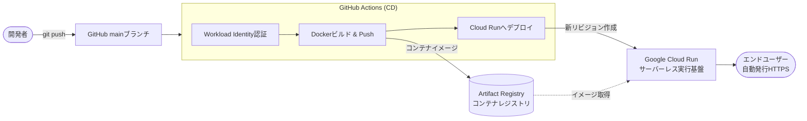

## デプロイパイプラインの全体像

GitHubへのpushを契機に、Dockerイメージのビルド、レジストリへの保存、Cloud Runへのデプロイまでが全自動で進行する。



### 登場する主要サービス
- **Artifact Registry**:  
  Google Cloudにおける最新のコンテナレジストリサービス（旧 Container Registry の後継）。Dockerイメージを安全に非公開保存・バージョン管理する。
- **Google Cloud Run**:  
  コンテナをそのままサーバーレスで実行できるフルマネージドサービス。
  - **自動TLS/HTTPS**: デプロイすると即座に一意な公開URL（`https://...run.app`）が発行される。
  - **ゼロスケール**: リクエストがない待機時はインスタンス数が0台になり、課金が発生しない。
  - **即時スケール**: トラフィック急増時に数秒でコンテナが自動増設される。


## 必要なファイルと設定

```yaml title=".github/workflows/cd.yml"
name: Deploy to Google Cloud Run

on:
  push:
    branches:
      - main

# OIDCトークン発行のために id-token の write 権限が必須
permissions:
  contents: read
  id-token: write

env:
  # 環境に合わせて設定 (Variablesで管理してもよい)
  PROJECT_ID: ${{ vars.GCP_PROJECT_ID }}
  REGION: asia-northeast1
  GAR_REPOSITORY: my-docker-repo
  SERVICE_NAME: my-web-app

jobs:
  deploy:
    runs-on: ubuntu-latest

    steps:
      # 1. リポジトリのコードをチェックアウト
      - name: Checkout repository
        uses: actions/checkout@v4

      # 2. Workload Identity連携によるGoogle Cloud認証 (サービスアカウントキー不要)
      - name: Authenticate to Google Cloud
        id: auth
        uses: google-github-actions/auth@v2
        with:
          project_id: ${{ env.PROJECT_ID }}
          workload_identity_provider: ${{ vars.GCP_WORKLOAD_IDENTITY_PROVIDER }}
          service_account: ${{ vars.GCP_SERVICE_ACCOUNT }}

      # 3. Docker CLIからArtifact Registryへの認証を設定
      - name: Set up Docker credentials for Artifact Registry
        run: |
          gcloud auth configure-docker ${{ env.REGION }}-docker.pkg.dev --quiet

      # 4. Docker Buildxの準備
      - name: Set up Docker Buildx
        uses: docker/setup-buildx-action@v3

      # 5. DockerイメージのビルドとArtifact Registryへのプッシュ
      - name: Build and Push Container Image
        uses: docker/build-push-action@v6
        with:
          context: .
          file: ./Dockerfile
          push: true
          # Artifact Registry のURL形式: {リージョン}-docker.pkg.dev/{プロジェクトID}/{リポジトリ名}/{イメージ名}:{タグ}
          tags: |
            ${{ env.REGION }}-docker.pkg.dev/${{ env.PROJECT_ID }}/${{ env.GAR_REPOSITORY }}/${{ env.SERVICE_NAME }}:${{ github.sha }}
            ${{ env.REGION }}-docker.pkg.dev/${{ env.PROJECT_ID }}/${{ env.GAR_REPOSITORY }}/${{ env.SERVICE_NAME }}:latest
          cache-from: type=gha
          cache-to: type=gha,mode=max

      # 6. Google Cloud Runへのデプロイ
      - name: Deploy to Cloud Run
        id: deploy
        uses: google-github-actions/deploy-cloudrun@v2
        with:
          service: ${{ env.SERVICE_NAME }}
          region: ${{ env.REGION }}
          image: ${{ env.REGION }}-docker.pkg.dev/${{ env.PROJECT_ID }}/${{ env.GAR_REPOSITORY }}/${{ env.SERVICE_NAME }}:${{ github.sha }}

      # 7. デプロイされた公開URLをログに出力
      - name: Show Output URL
        run: |
          echo "Application successfully deployed to: ${{ steps.deploy.outputs.url }}"
```

### 重要な設定とポイント

#### 認証ステップ: Workload Identity連携 (`google-github-actions/auth`)
従来の「JSON形式のサービスアカウントキーを発行してGitHub Secretsに登録する」方式は、キーの漏洩・紛失リスクが高いため非推奨となっている。

GitHub ActionsとGoogle Cloudを **OIDC (OpenID Connect)** で直接信頼づける **Workload Identity連携** を採用することで、
静的な認証鍵を一切持たずに一時的なアクセストークンを安全に生成できる。
ワークフロー側には以下の権限指定が必要となる。

```yaml
permissions:
  contents: read
  id-token: write  # GitHubのOIDCトークンを発行するために必要
```

#### Artifact RegistryのイメージURL規則
Artifact RegistryにおけるDockerイメージの完全修飾名は以下のフォーマットで指定する。

```text
{リージョン}-docker.pkg.dev/{プロジェクトID}/{リポジトリ名}/{イメージ名}:{タグ}
```
例: `asia-northeast1-docker.pkg.dev/my-project-123/my-docker-repo/my-web-app:abc1234`

#### Cloud Run デプロイ時の主要設定 (`deploy-cloudrun`)
`google-github-actions/deploy-cloudrun` アクションは、裏側で `gcloud run deploy` コマンドを実行する。
必要に応じて `flags` オプション等で以下のチューニングを行える。

```yaml
- name: Deploy to Cloud Run
  uses: google-github-actions/deploy-cloudrun@v2
  with:
    service: ${{ env.SERVICE_NAME }}
    region: ${{ env.REGION }}
    image: ${{ env.REGION }}-docker.pkg.dev/${{ env.PROJECT_ID }}/${{ env.GAR_REPOSITORY }}/${{ env.SERVICE_NAME }}:${{ github.sha }}
    flags: |
      --port=8080
      --memory=512Mi
      --cpu=1
      --min-instances=0
      --max-instances=10
      --set-env-vars=ENV=production
```

- **`--port`**: コンテナ側でWebサーバーがリッスンしているポート番号（デフォルト: `8080`）。
- **`--min-instances=0`**: ゼロスケールを有効化（アクセスがない時はインスタンス数を0にして課金を防ぐ）。
- **`--max-instances`**: 急激なアクセスやDDOS攻撃による想定外の課金スパイクを防止するための上限数。
- **`--set-env-vars`**: アプリケーションに渡す環境変数の指定。


## リビジョン管理とゼロダウンタイム
Cloud Runへ新しいイメージがデプロイされると、**新しいリビジョン（Revision）** が作成される。

1. **新コンテナの立ち上げ**: 新しいイメージを元にコンテナインスタンスが初期化される。
2. **ヘルスチェック**: コンテナが指定ポートで正常に応答を開始したことを確認する。
3. **トラフィックの即時切り替え**: ヘルスチェック成功後、100%のトラフィックが旧リビジョンから新リビジョンへと無停止（ゼロダウンタイム）で移行する。
4. **旧リビジョンの縮小**: 処理中のリクエストが完了次第、旧インスタンスは自動的に停止される。

万が一新しいイメージが起動時にクラッシュした場合は、トラフィックの切り替えが行われず、旧リビジョンが稼働し続けるため、サービス停止を回避できる。
